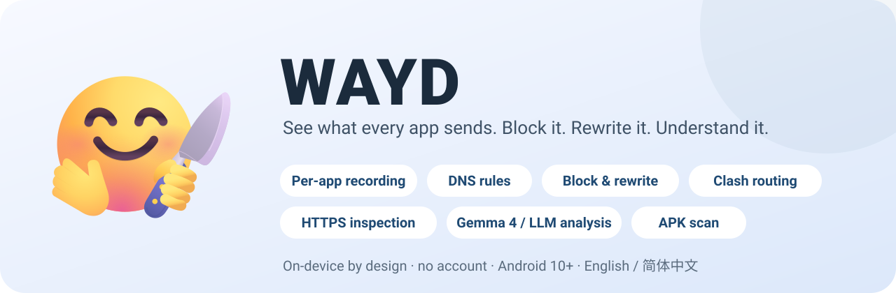
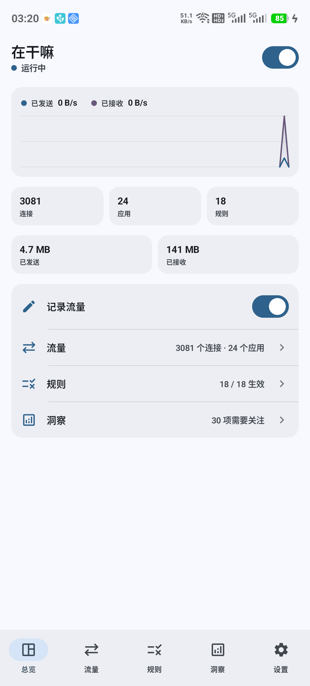
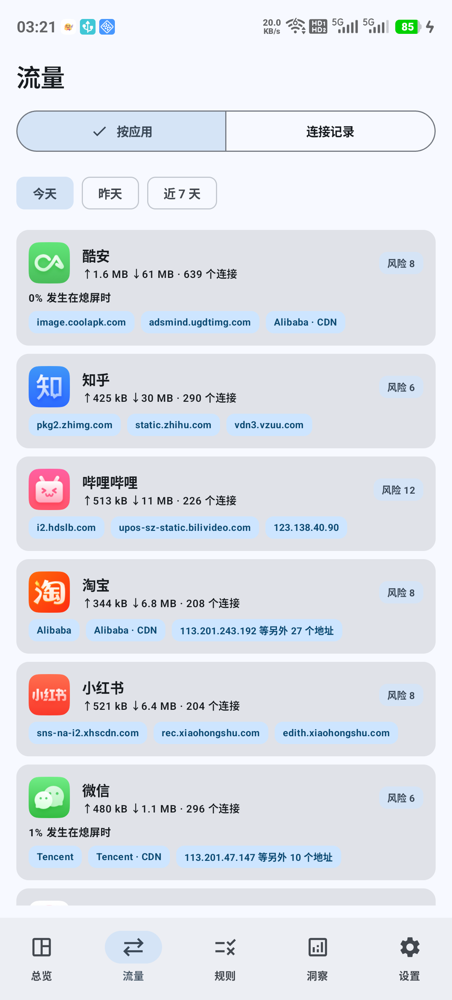
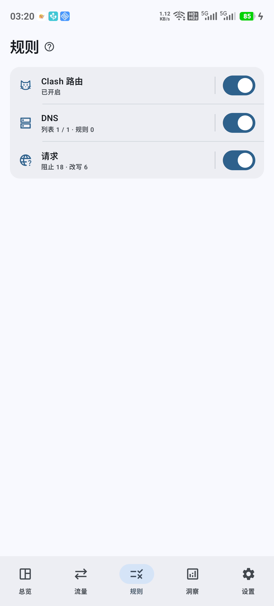
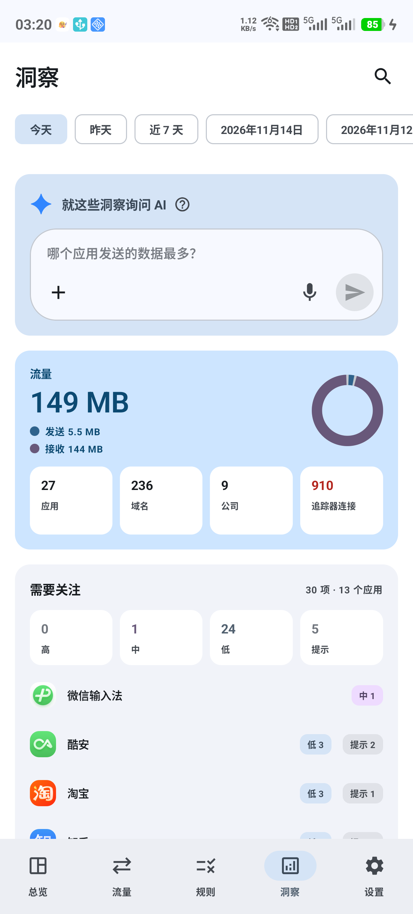
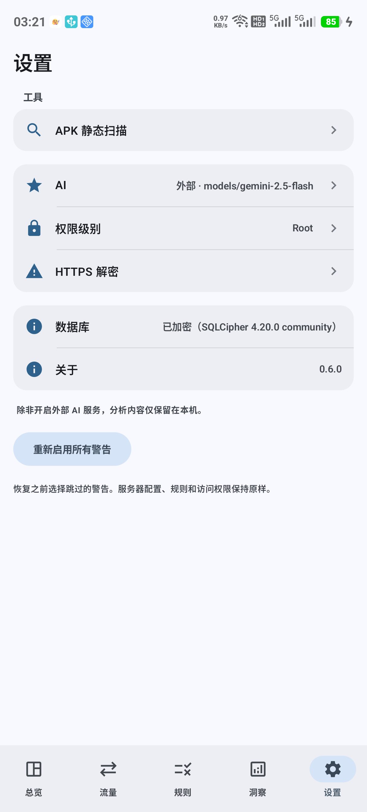

  

#  在干嘛 · WAYD (What Are You Doing)

> An on-device Android privacy monitor that records what every app on your phone sends and receives, explains it in plain language, and helps you stop what you don't want.

- **Package:** `com.nathanhanapps.wayd`
- **Publisher:** nathanhanapps
- **Platform:** Android 10+ (API 29+) — target latest stable SDK
- **UI:** Jetpack Compose + Material 3 Expressive
- **Core principle:** On-device inspection and analysis. WAYD inspects traffic and analyzes findings on your Android device. It never automatically uploads captured traffic, inspection logs, reports, or AI analysis. You can explicitly export data to a destination you choose. Apps still communicate with their destinations; user-initiated model/database downloads also use the network. An opt-in routing adapter forwards permitted traffic from selected apps through configured proxies. 
  
**One opt-in exception:** if you turn on an external OpenAI-compatible AI server, analysis text (hosts, IPs, app names, times, and decrypted content if you select it) is sent to the server you chose. It is off by default, needs a per-server acknowledgement, and shows you the exact text for approval before every send.

  
  
  
  
  

> **v0.6.0, work in progress.** Features first; UI and wording are still changing. English and 简体中文 (the screenshots are from the 简体中文 UI).

# Currently Capable of

- Per-app traffic recording (local VPN), with domains, companies and trackers
- DNS rules: local answers, dnsmasq / hosts import, record-type blocks
- Block lists and per-app blocking
- Clash rules (Mihomo-compatible, `clash` variant)
- Traffic editing (MITM): request rewrite rules for chosen apps
- LLM analysis: local Gemma 4 or an OpenAI-compatible API
- APK scanner, export / import, Quick Settings tile

More: [handoff](docs/HANDOFF.md) · [to-do](docs/TODO.md)

# Big Thanks and credit to

https://github.com/iTXTech/Daedalus

https://github.com/Loyalsoldier/surge-rules

https://github.com/chen08209/FlClash

